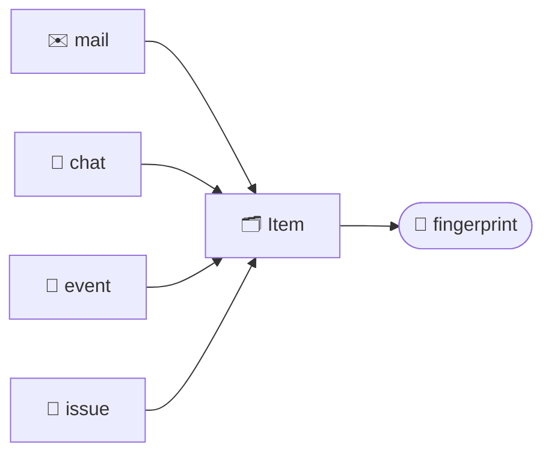

## One record for everything

@ diagram
! m c e t
Think of index cards. A mail, a chat message, a calendar event and a Jira issue look different, but the librarian writes each one on the same kind of card.
! card
Every card has the same boxes: where it came from, who, a title, a few lines of text, when. Some boxes stay empty: a mail has no start time, an event has no status.
Why the same card for all? Because the robot's favourite question is "anything new?", and the answer should be one list, sorted by time, whatever the source. Same card, same drawer, same sorting.
! hash
Each card also gets a fingerprint: a short code made from its content. If the same card comes back from Jira tomorrow with the same fingerprint, nothing changed and nobody is told.
@ types:karl-core::model
Now the code. The card is a struct called Item, and its kind says which of the four it is.
! karl-core::model::Kind
Kind has four values: Msg, Mail, Event, Task. It drives how a line is rendered and which command group lists it: msg, mail, cal or jira.
! karl-core::model::Item
Item has a source id, an external id from the provider, who, title, body, a timestamp, and optional fields: start and end for events, status, priority and key for tasks.
? Why not one struct per kind?
  Because `karl new` wants everything that changed, in one call, ordered by one counter. Four tables would mean four queries, four cursors and four renderers for the same question. Empty optional fields cost nothing in SQLite.
@ flow:karl-core::model::Item::content_hash
The fingerprint is the method content_hash. Let's read it slowly.
! karl-core::model::Item::content_hash/b2 karl-core::model::Item::content_hash/b3
It feeds a hash function with every field a person would notice changing: who, title, body, status, priority, the thread name. A zero byte between each, so two fields cannot blur into one.
! karl-core::model::Item::content_hash/b5 karl-core::model::Item::content_hash/b8
= crates/karl-core/src/model.rs:161:39-53
Then the timestamp, the event times, and two flags: all-day, and whether the task is done.
! karl-core::model::Item::content_hash/b11
Not the url, not the sequence number: those are not content. The result is sixteen bytes in hex. The drawer compares this on every sync. That drawer is the next part.
