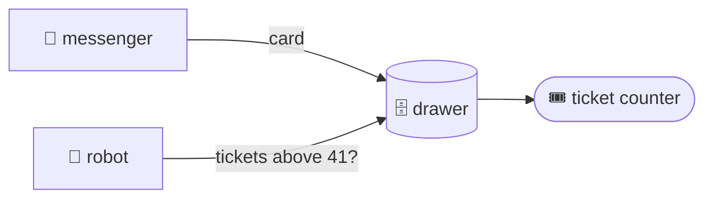

## The cache and the seq counter

@ diagram
! drawer
The drawer is a SQLite file. The messengers put cards in; the robot only reads. Reading never waits for the internet.
! counter
Here is the trick that makes "anything new?" cheap. Like a bakery, the drawer has a ticket counter. Every new card, and every card whose fingerprint changed, gets the next ticket number.
! robot
The robot remembers the last ticket it saw. "Anything new?" means: give me every card with a bigger ticket number. One comparison. No clocks from four different providers to argue about.
And a card that came back unchanged keeps its old ticket. So re-downloading seven hundred issues every five minutes creates no news at all.
@ flow:karl-core::store::upsert_in
Now the code. Cards go in through upsert_in: one card, one transaction, and one of three answers: inserted, updated, or unchanged.
! karl-core::store::upsert_in/b1 karl-core::store::upsert_in/b2
First, the fingerprint of the incoming card, and a look for the row with the same source and external id.
! karl-core::store::upsert_in/b7 karl-core::store::upsert_in/b8 karl-core::store::upsert_in/b9
= crates/karl-core/src/store.rs:471:25-33
Same row, same fingerprint: only the synced-at time is touched. Unchanged. No new ticket.
! karl-core::store::upsert_in/b10 karl-core::store::upsert_in/b11 karl-core::store::upsert_in/b12
= crates/karl-core/src/store.rs:479:23-35
Same row, different fingerprint: next_seq hands out a fresh ticket and the row is rewritten. Updated. A status change on an issue is news.
! karl-core::store::upsert_in/b14 karl-core::store::upsert_in/b15 karl-core::store::upsert_in/b16
No row at all: insert, also with a fresh ticket. The question mark after each execute hands any database error back to the caller, which rolls the transaction back.
? What is seq, exactly?
  A counter kept in the meta table and bumped inside the same transaction, so it is monotonic even across restarts. Every profile keeps a cursor: the last seq it has seen. New is seq above cursor.
@ flow:karl-core::store::Store::since_seq
Reading is the mirror image.
! karl-core::store::Store::since_seq/b4 karl-core::store::Store::since_seq/b6 karl-core::store::Store::since_seq/b8
since_seq takes a strategy. Changes compares the ticket number, which moves on every edit. Arrivals compares the ticket the card was first inserted with, which never moves.
! karl-core::store::Store::since_seq/b10 karl-core::store::Store::since_seq/b11
= crates/karl-core/src/store.rs:292:61-69
Then one select: cards with that column above the bookmark, oldest first, with a limit. where_clause adds the sources this person may see and the kind asked for, as bound parameters.
? What about full-text search?
  An FTS5 virtual table mirrors title, body, who and thread name through three triggers. `karl mail find invoice q3` becomes a match query with every word quoted and prefixed, so operators typed by the robot are literal, not injected.
!
That is the drawer: write with a fingerprint, read with a number. Now the window the robot knocks on.
