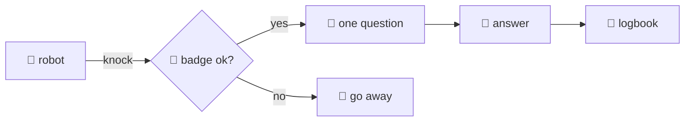

## Through the socket

@ diagram
! robot badge
On the librarian's side, every knock is handled the same way. First: who is knocking? The operating system tells the librarian which user is on the other end. No password, no token: the badge is the user id.
! out
Wrong badge: a line in the logbook, a polite no, and the connection ends.
! q ans
Right badge: read one question, answer it, close. One question per knock. Nothing stays open.
! log
And every single knock goes in the logbook: who, what, the exit code, how big, how long. The robot cannot read that book.
@ flow:karld::server::serve_profile
Now the code. Each person has their own window: serve_profile binds the socket with mode 660 and the client group, then accepts forever.
! karld::server::serve_profile/b5 karld::server::serve_profile/b6 karld::server::serve_profile/b8
Every connection becomes a task running handle_conn. The profile index travels with it: the socket path already says who is asking.
@ flow:karld::server::handle_conn
! karld::server::handle_conn/b4 karld::server::handle_conn/b5 karld::server::handle_conn/b6
= crates/karld/src/server.rs:50:21-38
Here is the badge check: peer credentials from the kernel, the uid of the process on the other end.
! karld::server::handle_conn/b10 karld::server::handle_conn/b11 karld::server::handle_conn/b12 karld::server::handle_conn/b13
= crates/karld/src/server.rs:57:8-29
Not in the profile's list: audit, deny, return.
! karld::server::handle_conn/b14
A semaphore permit: four questions at a time per person; the fifth is told to retry.
! karld::server::handle_conn/b16
= crates/karld/src/server.rs:71:18-53
Everything else runs under one timeout of twenty seconds, including any live lookup.
! karld::server::handle_conn/b16
= crates/karld/src/server.rs:74:24-54
Inside: read one line, but at most the maximum request size plus one byte. A longer question is refused unread. Then decode, dispatch, write the answer, close the write side.
? What does the wire format look like?
  A JSON line from the client, `{"v":1,"args":["new"]}`. From the daemon, a JSON header line, `{"ok":true,"len":812,"exit":0}`, followed by exactly len bytes of body. Two lines and a body: readable with netcat.
! karld::server::handle_conn/b17 karld::server::handle_conn/b18 karld::server::handle_conn/b19
The logbook line: profile, uid, the words, exit code, bytes, milliseconds.
! karld::server::handle_conn/b22 karld::server::handle_conn/b23 karld::server::handle_conn/b24
A timeout is logged too, and the robot gets an error reply instead of silence.
@ flow:karl-core::proto::Reply::encode
! karl-core::proto::Reply::encode/b4 karl-core::proto::Reply::encode/b5 karl-core::proto::Reply::encode/b7
= crates/karl-core/src/proto.rs:86:13-27
encode is the whole answer format: a header built from the body's length and the exit code, one newline, then the body. The body always ends with a newline, so nothing gets glued to the robot's next thought.
!
Next, what the librarian does with the words, and in which order.
