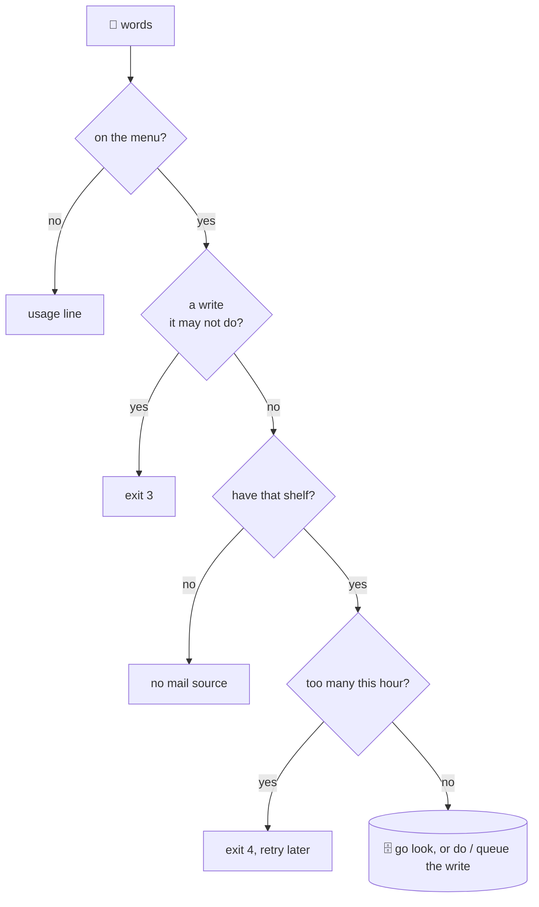

## Enforcement in order

@ diagram
! w p u
Before the librarian looks anything up, there is a checklist, always in the same order.
First: is this question on the menu at all? If not, the answer is the menu line for that group, so the robot learns the right words.
! wr deny
Second: is it asking to change something it is not allowed to change? Then no, before anything is looked up. Each person has a permission per source: forbidden, ask me first, or allowed.
! src u2
Third: do we even have that shelf? A person with no mail source gets "no mail source", not an empty list that would make the robot guess.
! rate wait
Fourth: too many questions this hour? Then wait. A robot that has been tricked into emptying a mailbox gets slow and visible.
! go
Only then does the librarian go to the drawer. Or, for an allowed write, does it, or puts it in the tray for you to approve.
@ flow:karld::dispatch::handle
Now the code. handle is that checklist, top to bottom.
! karld::dispatch::handle/b3 karld::dispatch::handle/b6 karld::dispatch::handle/b7
One: parse the words against the command table. An unknown word is exit 2 and a usage line.
! karld::dispatch::handle/b8 karld::dispatch::handle/b9
= crates/karld/src/dispatch.rs:25:37-84
Two: a write verb on a source where this person is not authorized is refused here. writable_source looks for a source of that group whose mode is not "not-authorized"; none means exit 3.
? What are the three write modes?
  Per person and per source, in the policy file. not-authorized, the default: every write refused, and the verb is not even in the menu. authorization-required: the write is queued and a human approves or denies it on the admin socket. authorized: it runs at once. Reads never need a mode.
! karld::dispatch::handle/b10 karld::dispatch::handle/b11
= crates/karld/src/dispatch.rs:34:38-66
Three: a group with no source for this person.
! karld::dispatch::handle/b12 karld::dispatch::handle/b13
= crates/karld/src/dispatch.rs:37:49-70
Four: the rate limiter, a sliding window per person. Over the limit is exit 4 with a retry hint.
! karld::dispatch::handle/b14 karld::dispatch::handle/b15 karld::dispatch::handle/b18 karld::dispatch::handle/b19
Five: a context with the person's line budget, then run. An internal error becomes exit 1 with a message. Nothing panics on this path.
@ flow:karld::dispatch::run
! karld::dispatch::run/b3
run is one big match over the parsed command. Each read arm queries the drawer, drops hidden cards, and ends in one of three finishers: a list of lines, one full text, or a plain reply.
The write arms land in a function called write. It has its own part, the next one.
? Where do hide and redact happen?
  In the finishers. finish drops cards the person's hide rules match, renders the rest, redacts the text, and caps it at max lines and max bytes. Every list goes through it, so no arm can forget.
!
Next: what happens when the robot wants to change something.
