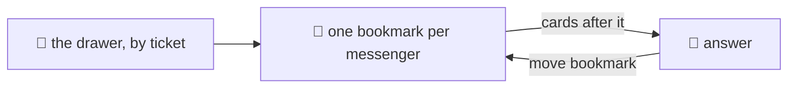

## What news means

@ diagram
! book mark
"Anything new on Jira?" is the question the robot will ask most. Picture a bookmark in a book sorted by ticket number. New means: the pages after the bookmark.
Each messenger has its own bookmark. Asking about Jira moves the Jira bookmark and leaves the mail one alone. "Anything new?" with no name is just all of them.
! ans
After answering, the librarian moves the bookmark to the last page shown. Ask again, and you get only what came after that.
Two messengers can mean two different things by "new". For Jira, a card that changed is news: an issue moved to Done. For mail, only a card that arrived is news: a mail is new once, when it comes.
Two more details a kid would ask about. The very first time you ask, the bookmark goes to today, not to page one. Seven hundred old issues are not news.
And when there is more than fits on one paper, the librarian gives one paper, moves the bookmark only that far, and writes "more: run again" at the bottom.
@ flow:karld::dispatch::news_items
Now the code. news_items, one messenger at a time.
! karld::dispatch::news_items/b7 karld::dispatch::news_items/b9 karld::dispatch::news_items/b10 karld::dispatch::news_items/b11
For each group asked for, and each of this person's sources in it: the source's strategy, changes or arrivals, and this person's bookmark for that source.
! karld::dispatch::news_items/b12 karld::dispatch::news_items/b13 karld::dispatch::news_items/b14 karld::dispatch::news_items/b15
= crates/karld/src/dispatch.rs:402:20-27
A bookmark of zero means never asked. It jumps to the current maximum, and the source is noted as started.
! karld::dispatch::news_items/b16 karld::dispatch::news_items/b17 karld::dispatch::news_items/b19
Otherwise: everything after the bookmark by that strategy, limited to max lines plus one, so we can tell whether more remains.
! karld::dispatch::news_items/b24 karld::dispatch::news_items/b27 karld::dispatch::news_items/b28 karld::dispatch::news_items/b29
= crates/karld/src/dispatch.rs:421:9-25
All sources merged and sorted by ticket, so mail and issues interleave in the order they happened. Over the budget: cut, and remember that there is more.
! karld::dispatch::news_items/b32 karld::dispatch::news_items/b33 karld::dispatch::news_items/b42 karld::dispatch::news_items/b43
Then each bookmark moves, but only to the last card actually shown from that source.
! karld::dispatch::news_items/b37 karld::dispatch::news_items/b39 karld::dispatch::news_items/b41
= crates/karld/src/dispatch.rs:433:43-55
Which number the bookmark takes depends on the strategy: the ticket that moves on edits, or the ticket the card arrived with.
! karld::dispatch::news_items/b47 karld::dispatch::news_items/b51 karld::dispatch::news_items/b52
The empty answer says which sources just started tracking, so a fresh profile does not look broken.
! karld::dispatch::news_items/b53 karld::dispatch::news_items/b54
= crates/karld/src/dispatch.rs:450:30-46
And when there is more: "more: run again". No page tokens, no ids. The bookmark is the page.
? What if the robot forgets what it read?
  Then that news is gone from its conversation, not from the drawer. `karl mail recent 2h` does not move the bookmark and brings it back. news is for "anything new?"; recent is for "what happened this afternoon?".
!
Next: the one thing we have not shown yet. What happens when the robot wants to write.
