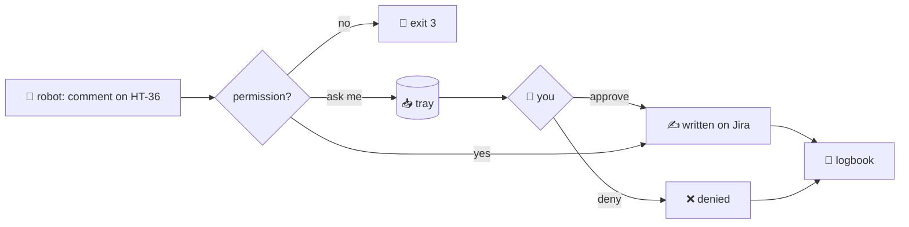

## Write permissions

@ diagram
! robot mode
Sometimes the robot wants to change something: add a comment on an issue, move it to Done. Reading was free. Writing needs permission, and the permission is yours, per person and per source.
! refused
Three settings. The first is no. That is the default: every write is refused before the librarian looks anything up, and the write words are not even on the robot's menu.
! tray you
The second is ask me. The librarian puts the request in a tray on your desk and tells the robot "queued, number twelve". Later you look at the tray and say yes or no to each slip.
! done denied log
Yes: the librarian does it and keeps the slip with the result. No: the slip is marked denied. Either way, one line in the logbook, and the robot can read the outcome with pending.
! mode done
The third is yes. The librarian does it at once and tells the robot what Jira answered.
? Why is "no" the default?
  Because a write is the one thing a tricked robot could do that you cannot undo by closing a chat. A comment on a work issue is visible to colleagues. So nothing is writable until you say so, source by source, and the first step up is "ask me", not "yes".
! robot
A full example, with the setting on ask me. You, on Discord: tell the team on HT-36 that the fix ships Friday.
! robot mode
The robot runs `karl jira comment HT-36 fix ships Friday`.
! tray
The librarian answers: queued, number twelve, for approval: comment HT-36: fix ships Friday. The robot tells you: I have queued the comment, it needs your approval.
! you
Later, as the librarian's user, you run `karl admin approvals`. It shows: number twelve, three minutes ago, alex, jira, comment HT-36: fix ships Friday.
! you done
You run `karl admin approve 12`. The librarian posts the comment and answers: number twelve done: commented on HT-36.
! log
The robot checks with `karl pending` and reads: number twelve, done, jira, comment HT-36: fix ships Friday, commented on HT-36. The logbook has two lines: queued, then approved.
! denied
Had you run `karl admin deny 12` instead, the slip would read denied, and Jira would never have heard of it.
Same example with the setting on yes: the comment is posted the moment the robot asks, and the answer is Jira's confirmation. With the setting on no: exit 3, writes not authorized for jira, and the robot did not even have the word comment on its menu.
@ types:karl-core::policy
Now the code. The permission is an enum called Mode, with three values.
! karl-core::policy::Mode
NotAuthorized, AuthorizationRequired, Authorized. In the policy file they are written as not-authorized, authorization-required and authorized, with short aliases no, ask and yes.
@ flow:karl-core::policy::ProfileCfg::mode_for
! karl-core::policy::ProfileCfg::mode_for/b1
= crates/karl-core/src/policy.rs:186:24-42
mode_for answers the question "may this person write to this source?". A source with no entry gets NotAuthorized. The default is no.
@ flow:karld::dispatch::write
When a write verb passes the checklist, it lands in write.
! karld::dispatch::write/b2
First, which source of the group this person may write to, and with which mode. The checklist already refused the case where there is none.
! karld::dispatch::write/b3
= crates/karl-sources/src/lib.rs:77:13-39
Then the words become a request: comment with a key and a text, or move with a key and a status. Anything else is a usage line. There is no third shape.
! karld::dispatch::write/b5 karld::dispatch::write/b6 karld::dispatch::write/b7 karld::dispatch::write/b8
Authorized: run it on the source now, write one audit line with the result, and answer the provider's confirmation, or its error.
! karld::dispatch::write/b9 karld::dispatch::write/b10
= crates/karld/src/dispatch.rs:342:18-52
Authorization required: the request goes into the writes table with a number. This is the tray.
! karld::dispatch::write/b11 karld::dispatch::write/b12
= crates/karld/src/dispatch.rs:349:18-42
An audit line, and the robot is told "queued, number twelve, for approval". It did not happen yet, and the robot knows that.
@ flow:karld::dispatch::pending
! karld::dispatch::pending/b3 karld::dispatch::pending/b15 karld::dispatch::pending/b17
pending is the robot's view of the tray: its own slips, newest first, each with a status, pending, done, denied or failed, and the result when there is one.
@ flow:karld::admin::handle
Your side is the admin socket, mode 600, reachable only as the librarian's own user. Three verbs: approvals, approve, deny.
! karld::admin::handle/b23 karld::admin::handle/b25 karld::admin::handle/b40
approvals lists every pending slip, from every person: number, age, who, which source, what.
! karld::admin::handle/b42 karld::admin::handle/b46 karld::admin::handle/b53 karld::admin::handle/b54
= crates/karld/src/admin.rs:114:16-36
approve and deny share one arm. Fetch the slip by number; a slip that is not pending any more is refused, so nothing runs twice.
! karld::admin::handle/b55 karld::admin::handle/b56 karld::admin::handle/b57 karld::admin::handle/b58
= crates/karld/src/admin.rs:118:65-72
deny marks it denied, logs it, and that is all.
! karld::admin::handle/b59 karld::admin::handle/b60
= crates/karld/src/admin.rs:134:26-60
approve parses the slip again and runs it through the same execute_write as the authorized path. One way to write, whoever pressed the button.
! karld::admin::handle/b61 karld::admin::handle/b67 karld::admin::handle/b68
The slip is updated with done or failed and the text of the result, and the audit line says approved, by whom, and what came back.
? How do I approve from my laptop?
  Over ssh, as the daemon's user: `scripts/karl admin approvals` in development, or on the box `sudo -u karl KARL_SOCK=/run/karl/admin.sock karl approvals`, then `approve 12` or `deny 12`. The robot never reaches that socket: its own socket does not know these verbs at all.
!
That is writing: no by default, a tray when you want a say, one door either way. Next, how a card becomes one short line of text.
