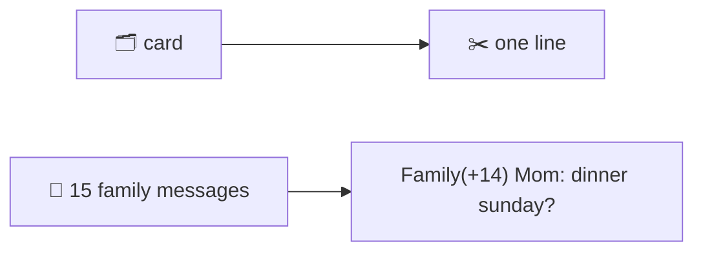

## One line per item

@ diagram
! card line
The librarian never hands over a whole letter. Each card becomes one line: who it is from, the title, and the first words of the text, cut short with a note that there is more.
! fam fold
A family chat with fifteen new messages does not become fifteen lines. It becomes one: the group's name, how many, and the last message.
Why so stingy? Every word the robot reads costs time on its slow model. A line it does not need is seconds wasted on every turn. So the rule is: drop what is not information.
@ flow:karl-core::render::listing
Now the code. listing turns cards into lines, in order, and folds the noisy chats.
! karl-core::render::listing/b6 karl-core::render::listing/b7 karl-core::render::listing/b9 karl-core::render::listing/b10
A first pass over chat messages only: count the messages per thread, and remember where each thread's last message sits.
! karl-core::render::listing/b12 karl-core::render::listing/b13 karl-core::render::listing/b14
The second pass emits. Anything that is not a chat message is one line, no questions asked.
! karl-core::render::listing/b18 karl-core::render::listing/b19
A thread with three messages or fewer prints them all.
! karl-core::render::listing/b20 karl-core::render::listing/b25 karl-core::render::listing/b26
= crates/karl-core/src/render.rs:153:39-67
A busier thread prints once, where its last message was, with the count folded into the name. Fifteen messages, one line.
@ flow:karl-core::render::line
line builds one card's text. Let's read the mail case and the task case.
! karl-core::render::line/b1
It starts with the source id, like gm or jira. So the kind is implied and the robot can name the source back.
! karl-core::render::line/b13 karl-core::render::line/b14 karl-core::render::line/b16
A mail: who, colon, subject.
! karl-core::render::line/b18 karl-core::render::line/b20
= crates/karl-core/src/render.rs:73:16-24
Then a dash and the body, flattened to one line and cut to whatever room is left. If fewer than twenty-four characters are left, the body is skipped: a cut that short is noise.
! karl-core::render::line/b28 karl-core::render::line/b29 karl-core::render::line/b31
A task: key, status, then priority.
! karl-core::render::line/b33 karl-core::render::line/b34
= crates/karl-core/src/render.rs:94:60-73
Notice the filter on priority. Medium is Jira's default, so it says nothing, so it is not printed.
! karl-core::render::line/b23 karl-core::render::line/b24
An event is its time span, which omits the date when it is today, and its title.
? Where do the short bodies come from?
  The text module cleans at sync time: HTML stripped, quoted replies and signatures dropped, whitespace collapsed. At render time one_line joins the lines with a return mark and cuts at the budget with a tail like plus 340 c, so the robot knows there is more and can ask for the full text with show.
!
Those line formats, and the words the robot may type, are the two rulebooks. Next part.
