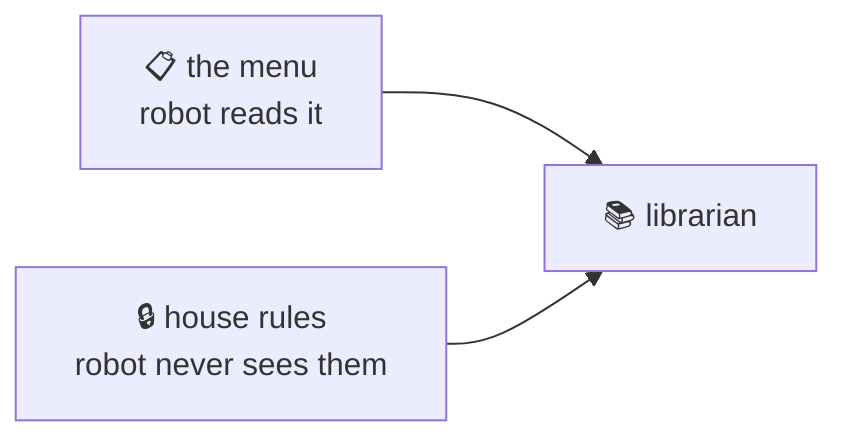

## Two contracts

@ diagram
! menu
There are two rulebooks. The first is the menu: the exact questions the robot may ask. It is about eighty words long, and the robot has it in its head at all times.
! rules
The second is the house rules: what to hide, what to blur, how many questions an hour, and the write permission per source. The robot never sees this one. It only notices that some things are not there.
The write permission has three values: not authorized, which is the default; authorization required, where you see each request in a tray and say yes or no; and authorized.
Keeping them apart is the point. The menu is tiny because the rules are elsewhere. And the rules can change without the robot being told anything.
@ code:karl-core::commands::Command::parse
Now the code. The menu lives in one table in the commands module. It drives parsing, the printed index, and the dispatcher, so the three cannot drift.
! karl-core::commands::Command::parse/b31
= crates/karl-core/src/commands.rs:291:22-44
parse is a match over the words: msg new, mail recent and a duration, cal and a date, jira show and a key.
! karl-core::commands::Command::parse/b31
Every error is the usage text the robot should read. An unknown first word points it back to the menu.
! karl-core::commands::Command::parse/b18 karl-core::commands::Command::parse/b21 karl-core::commands::Command::parse/b22
Small closures check each argument. An issue key must be letters, a dash, digits, nothing else. No path and no query can ride in on it.
@ code:karl-core::commands::index
! karl-core::commands::index/b2 karl-core::commands::index/b3 karl-core::commands::index/b4
index prints the menu: one line per group, only groups that have a source for this person.
! karl-core::commands::index/b5 karl-core::commands::index/b6 karl-core::commands::index/b8
= crates/karl-core/src/commands.rs:316:41-54
The write verbs of a group, comment and move, are added only when this person may write there. A person who may not write never even learns the words.
? Why not a tool schema, like MCP?
  Because on a CPU model every schema token sits in the prompt every turn. A shell command the robot already knows costs nothing until it is used, and the eighty-word menu can sit in the system prompt, stable, cached. Fewer tools also means fewer ways for a small model to get confused.
@ flow:karl-core::policy::Profile::compile
The house rules are the policy file. Profile compile turns one person's rules into something fast to apply on every question.
! karl-core::policy::Profile::compile/b1 karl-core::policy::Profile::compile/b3
Hide rules, like gm colon label equals Bank, become a source, a field and a pattern built from the glob.
! karl-core::policy::Profile::compile/b4 karl-core::policy::Profile::compile/b7 karl-core::policy::Profile::compile/b8
= crates/karl-core/src/policy.rs:213:44-50
Blur rules are built-in patterns: otp matches six to eight digit codes, card matches long digit runs. They run on the final text, after rendering, so nothing slips around them.
! karl-core::policy::Profile::compile/b13
And the rate, like sixty per hour, is parsed once into a count and a window.
@ flow:karl-core::policy::RateLimiter::check
! karl-core::policy::RateLimiter::check/b1 karl-core::policy::RateLimiter::check/b2 karl-core::policy::RateLimiter::check/b3
check is a sliding window. First, forget the questions that fell out of the window.
! karl-core::policy::RateLimiter::check/b6 karl-core::policy::RateLimiter::check/b8 karl-core::policy::RateLimiter::check/b9
= crates/karl-core/src/policy.rs:394:12-45
If what is left fills the budget, answer how long until the oldest one expires. Otherwise record this one and allow it.
!
Now the other direction: how cards get into the drawer. A messenger, Jira.
