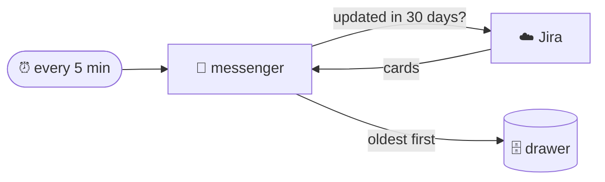

## A source: Jira

@ diagram
! tick msgr
A messenger is a small program with one job. Every few minutes it goes to one place, Jira here, and asks: what changed lately?
! jira
It brings back the cards, oldest first, and puts them in the drawer. The drawer decides which ones are actually new, using the fingerprints.
! drawer
The messenger mostly reads. It knows exactly two things it may write on Jira, a comment and a move to another status, and it does them only when the librarian hands it an approved request. It cannot delete anything.
@ types:karl-sources
Now the code. Every messenger implements one trait: an id, a kind, sync, and optionally live lookups and a start-up check.
! karl-sources::Source
Source is object safe, so the daemon keeps a map of boxed sources and never knows which is which. build picks the implementation from the kind in the policy file.
@ flow:karl-sources::jira::Jira::sync
! karl-sources::jira::Jira::sync/b2 karl-sources::jira::Jira::sync/b3 karl-sources::jira::Jira::sync/b5
sync starts by learning who the key belongs to, once, and keeps the account id in the drawer's meta table. That is what makes `jira mine` a local question.
! karl-sources::jira::Jira::sync/b7 karl-sources::jira::Jira::sync/b8 karl-sources::jira::Jira::sync/b10
= crates/karl-sources/src/jira.rs:268:32-46
The question to Jira: everything updated in the last window, thirty days by default, with an optional filter from the policy file in front.
! karl-sources::jira::Jira::sync/b11 karl-sources::jira::Jira::sync/b12
= crates/karl-sources/src/jira.rs:274:9-35
Then the search, and a sort by time, oldest first. Insert order is ticket order, and ticket order should follow time, so that "new" reads like a timeline.
! karl-sources::jira::Jira::sync/b15 karl-sources::jira::Jira::sync/b16
One upsert_many in one transaction, and a small report: fetched, inserted, updated. It feeds the log and the status line.
@ flow:karl-sources::jira::Jira::search
! karl-sources::jira::Jira::search/b3 karl-sources::jira::Jira::search/b4 karl-sources::jira::Jira::search/b7 karl-sources::jira::Jira::search/b9
search turns the pages: at most a hundred issues per request, and a next-page token when the server gives one.
! karl-sources::jira::Jira::search/b11 karl-sources::jira::Jira::search/b12 karl-sources::jira::Jira::search/b13
Each issue becomes a card: key, summary, status and whether it is done, priority, assignee, project as the thread, labels, and the description turned from Jira's document format into plain text.
@ flow:karl-sources::jira::Jira::post
! karl-sources::jira::Jira::post/b1 karl-sources::jira::Jira::post/b2
= crates/karl-sources/src/jira.rs:66:18-50
Writes go through one door, post, and the door checks the address: only paths under slash rest slash api slash 3 slash issue. Anything else is refused before any request is sent.
@ flow:karl-sources::jira::Jira::move_to
! karl-sources::jira::Jira::move_to/b2 karl-sources::jira::Jira::move_to/b4
move_to first asks Jira which transitions the issue has right now. That is a read.
! karl-sources::jira::Jira::move_to/b9 karl-sources::jira::Jira::move_to/b19
= crates/karl-sources/src/jira.rs:127:29-44
Then it looks for one whose name matches, ignoring case. No match: an error that lists the names it found, and nothing was changed.
! karl-sources::jira::Jira::move_to/b20 karl-sources::jira::Jira::move_to/b21
A match: one post with the transition id, and a one-line confirmation for the robot.
? What keeps the writes small?
  Four things. Only two verbs exist. The post door accepts issue paths alone. The daemon hands over a write only after the person's mode allowed it or a human approved it. And the Google tokens are read-only by scope, checked at start, so mail and calendar cannot write at all.
!
Finally, the librarian's own day: how the daemon starts and what it keeps running.
