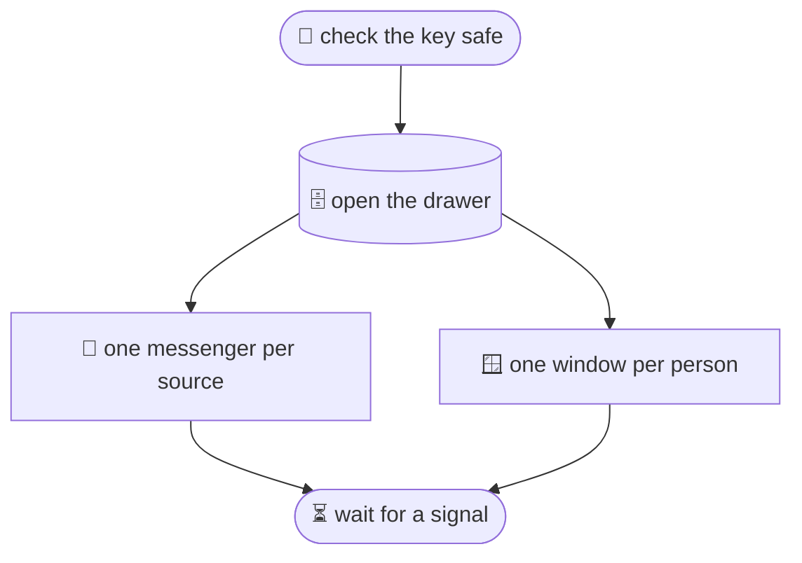

## The daemon boots

@ diagram
! start
When the librarian comes to work, the first thing is the key safe. If the safe can be opened by anyone else, the librarian refuses to start. A wrong permission is a loud error, not a quiet leak.
! drawer msgrs
Then the drawer is opened, and one messenger is sent out per source: Jira, Gmail, Calendar. Each runs on its own clock.
! windows wait
One window is opened per person. Then the librarian waits: for knocks, for messengers coming back, and for the signal to go home.
@ flow:karld::run
Now the code. run is the daemon's whole life in fifteen blocks.
! karld::run/b1 karld::run/b2
Load the config, build the App. That is where the secrets are read and checked, the drawer opened, every source constructed, every person's rules compiled.
@ flow:karld::state::App::build
! karld::state::App::build/b1
= crates/karl-core/src/policy.rs:446:12-28
Secrets load is the key-safe check: a file readable by anyone but its owner is refused.
! karld::state::App::build/b6 karld::state::App::build/b9 karld::state::App::build/b10 karld::state::App::build/b11
Open the SQLite file, build one boxed source per policy entry, and give each a notify handle, so the admin socket can say "sync now".
! karld::state::App::build/b13 karld::state::App::build/b14 karld::state::App::build/b16 karld::state::App::build/b17
Compile each person's rules and turn user names into uids from the passwd file.
! karld::state::App::build/b20 karld::state::App::build/b21
= crates/karld/src/state.rs:64:40-66
Root in a profile is refused outright. A root client would not need Karl, and a profile that admits it is a mistake.
@ flow:karld::run
! karld::run/b4 karld::run/b5
= crates/karld/src/main.rs:70:22-62
Back in run: one task per source, running its sync loop. Let's open that loop.
@ flow:karld::sync::run_source
! karld::sync::run_source/b4 karld::sync::run_source/b7 karld::sync::run_source/b17
The loop syncs under a ten-minute timeout, records the result for the status line, and logs one line.
! karld::sync::run_source/b18 karld::sync::run_source/b20
= crates/karld/src/sync.rs:32:13-54
On failure the wait doubles, capped at thirty minutes. A provider outage does not become a storm of retries.
! karld::sync::run_source/b23
= crates/karld/src/sync.rs:38:17-31
Then sleep, or wake early when the admin socket asks. That is tokio select: two futures, whichever finishes first.
@ flow:karld::run
! karld::run/b7 karld::run/b9 karld::run/b11
One task per person's window, and the admin window, mode 600, for status, sync and purge.
! karld::run/b12 karld::run/b14
Then wait for a signal, and on the way out remove the socket files. Around all this, the systemd unit gives the daemon no capabilities, a read-only system, no other homes, and the egress table.
? What does karld check do?
  The same build, then one call per source: who am I on Jira, the Gmail profile, the calendar name, and for Google the token's real scopes compared with the policy. Run it after every config change. It is the difference between "it starts" and "it can only do what we think".
!
One part left: where this goes.
