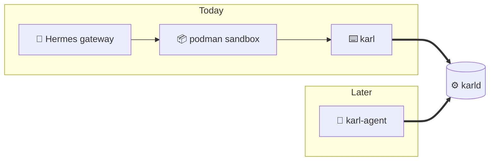

## Where this goes

@ diagram
! today h s c
Today the robot is Hermes, an agent written in Python. Its commands run in a locked container with no network, and that container gets exactly two things from Karl: the window program and the socket.
Adding Karl to Hermes is one line in the container setup and one paragraph in the robot's instructions: the menu.
! d
The librarian does not know or care who is knocking. The socket path says which person, the kernel says which user, and the menu says what can be asked.
> +a
! a
Later, the robot may be rewritten in Rust: Discord, the model loop, memory, timers. No locked container, because it has no general shell. No Python on the box. A short system prompt instead of a long one.
> -s
! a d
And the librarian stays exactly as it is. Same window, same menu, same lines. Nothing moves: the robot was always just another visitor at the window.
? Why not write the Rust robot now?
  Because context compaction, the tool loop with a small local model, and Discord's edge cases are months of polish that Hermes already has. Karl is needed either way, and it is the part that holds the keys. Build it, measure prompt tokens for a week, then decide with numbers.
!
That is Karl: one card, one ticket counter, one window, one line per thing, three write permissions, and house rules the robot never sees. Thanks for listening.
