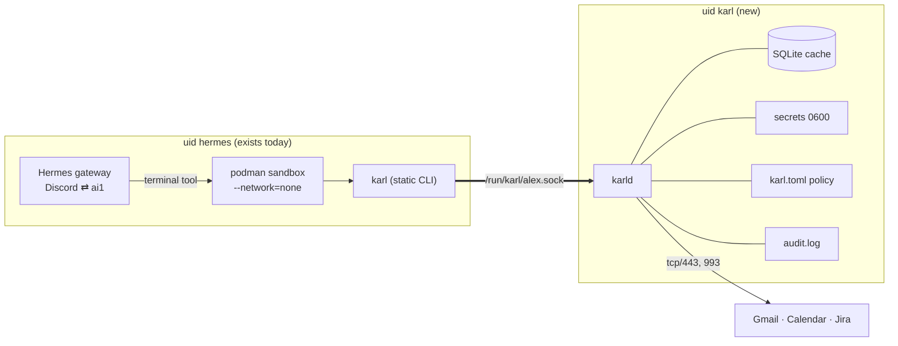
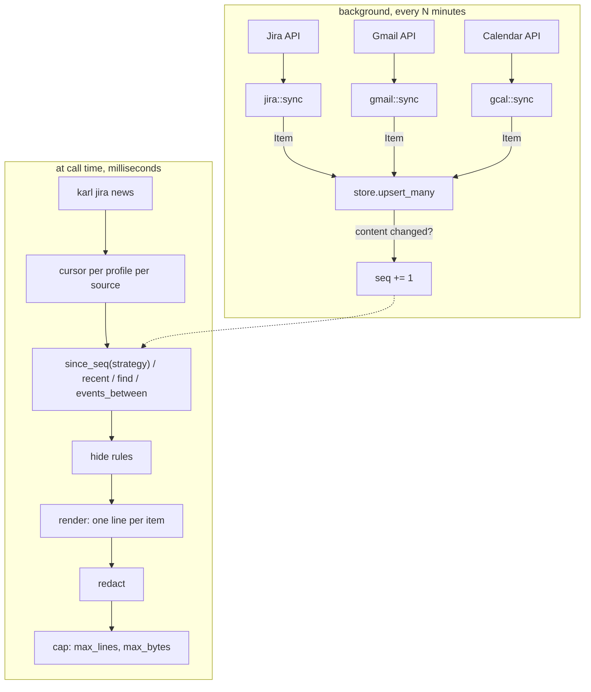

# Architecture

Two halves on one host, one unix socket between them.



## Crates

```text
crates/
  karl-core      lib  Item model, SQLite store, policy, renderer, command table, wire protocol
  karl-sources   lib  jira, gmail, gcal: each implements Source and syncs into the store
  karld          bin  config, sync loops, profile sockets, dispatcher, admin socket, audit
  karl           bin  the client: argv → socket → stdout, ~150 lines, no dependencies worth naming
```

`karl-core` has no network and no async: it is the part a future agent links
directly. `karl-sources` is the only crate that talks to the internet.
`karld` is glue. `karl` knows nothing but the socket path.

## Data flow



One `Item` type for everything. A mail, a chat message, an event and an issue
differ by `Kind` and by which optional fields are filled; they share the
table, the cursor, the full-text index and the renderer.

`seq` is a global counter bumped on every insert and every content change
(hash of the fields a person would notice); `created_seq` is the `seq` an
item was inserted with. "New" is one integer comparison against the
profile's cursor for that source: `seq > cursor` for sources whose edits
are news (Jira, Calendar), `created_seq > cursor` for sources where only
arrivals are (mail, chat). A re-sync that changes nothing creates no news.

## The three contracts

- [Commands](commands.md): what the model types. One table in `karl-core::commands`
  drives parsing, the index and the dispatcher.
- [Protocol](protocol.md): what crosses the socket. Two JSON lines and a body.
- [Policy file](policy.md): what the daemon enforces. Never in the model's context.
