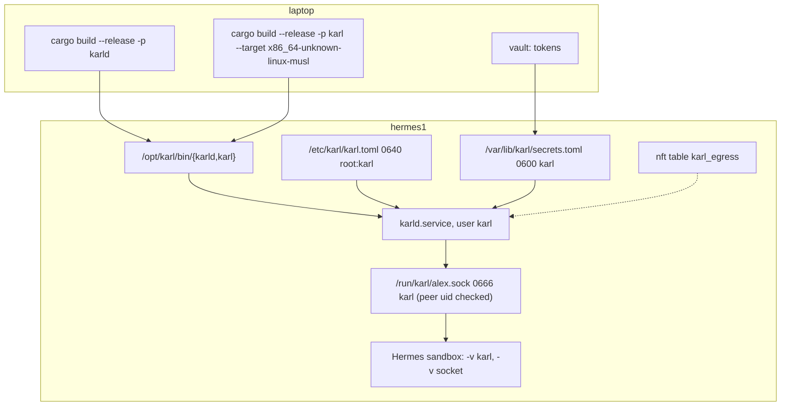

# Deploy

Target: `hermes1`, next to the Hermes gateway, as a separate unprivileged
user. Files under `deploy/` in the repository: a systemd unit, an nftables
egress table, an ansible role skeleton, and the sandbox mount notes.



## Build

```sh
scripts/karl build
# = cargo build --release -p karld                                   (glibc, runs on the Ubuntu box)
#   cargo build --release -p karl --target x86_64-unknown-linux-musl (static, goes into the sandbox)
```

The musl target needs `rustup target add x86_64-unknown-linux-musl`; the CLI
has no C dependencies, so no musl toolchain is needed. Result: ~500 KB.

## Users, files, modes

| | |
| --- | --- |
| user `karl` | system user, no shell, no sudo |
| sockets | 0666 in `/run/karl` 0755: the rootless sandbox keeps no supplementary groups under runc, so a group bit would not reach it. The daemon's peer-uid check is the gate (`socket_mode` in `[daemon]`) |
| `/opt/karl/bin/karld`, `karl` | 0755 root |
| `/etc/karl/karl.toml` | 0640 root:karl |
| `/var/lib/karl/` | 0700 karl: `karl.db`, `secrets.toml` (0600) |
| `/var/log/karl/audit.log` | 0600 karl |
| `/run/karl/` | 0755 karl, created by the unit |

## The unit

`deploy/karld.service`: `User=karl`, empty capability set, `ProtectSystem=strict`,
`ProtectHome`, `PrivateDevices`, `RestrictAddressFamilies=AF_INET AF_INET6 AF_UNIX`,
`SystemCallFilter=@system-service`, `StateDirectory`, `LogsDirectory`,
`RuntimeDirectory`. `TZ` is set in the unit: the agenda renders in it.

```sh
systemctl enable --now karld
systemctl status karld
journalctl -u karld -n 50
sudo -u karl KARL_SOCK=/run/karl/admin.sock /opt/karl/bin/karl status      # admin verbs
sudo -u karl KARL_SOCK=/run/karl/admin.sock /opt/karl/bin/karl approvals   # queued writes
sudo -u karl KARL_SOCK=/run/karl/admin.sock /opt/karl/bin/karl approve 12
```

## Egress

`deploy/karl-egress.nft`: for uid `karl` only, allow DNS to the router,
tcp/443 and tcp/993 to public addresses, drop every private range, drop the
rest. Same shape as the Hermes table; one kernel table, no daemon. Set the uid
and the router address at the top.

```sh
nft -f /etc/nftables.d/karl-egress.nft
nft list table inet karl_egress        # counters
journalctl -k | grep karl-egress       # drops
```

## Hermes

Two lines in the Hermes role's `docker_extra_args` and one paragraph in
`SOUL.md`. The exact text is in `deploy/hermes-sandbox.md`.

```yaml
    - "-v"
    - "/opt/karl/bin/karl:/usr/local/bin/karl:ro"
    - "-v"
    - "/run/karl/{{ item.name }}.sock:/run/karl.sock"
```

Each profile mounts its own socket, so the daemon knows who is asking from
the path. Inside the rootless container uid 0 is the host's `hermes`, which is
the uid in the profile's list. Nothing else about the Hermes setup changes:
no new port, no nftables change on the Hermes side (`oif lo` was already
accepted, and a unix socket is not even that).

## Ansible

The real role is `minipc/ansible/roles/karl` in the setup repository: user,
directories, the two binaries from the laptop build (`karl_build_dir`),
`karl.toml` rendered from `karl_sources` / `karl_profiles`, `secrets.toml`
from `vault_karl_secrets`, the egress table (`karl_egress_tcp_ports`,
`karl_egress_lan_allow` for a Matrix homeserver on the LAN) and the unit. The
Hermes role there adds the two bind mounts to every profile listed in
`karl_profiles` and the `karl` paragraph to its `SOUL.md`. `deploy/ansible/`
here is only the shape.

## Check

```sh
sudo -u karl /opt/karl/bin/karld check          # credentials, scopes, profiles
sudo -u karl /opt/karl/bin/karld sync           # one pass, prints counts
sudo -u hermes KARL_SOCK=/run/karl/alex.sock /opt/karl/bin/karl   # the index, as the agent sees it
```

## Measure

The point of the design is prompt tokens. Before and after adding Karl to the
profile, compare `prompt_tokens` in llama-server's response `usage` (or its
`/metrics`) for one turn that calls a tool. The Karl index adds ~80 tokens to
the stable prefix; a reply is a few hundred.
