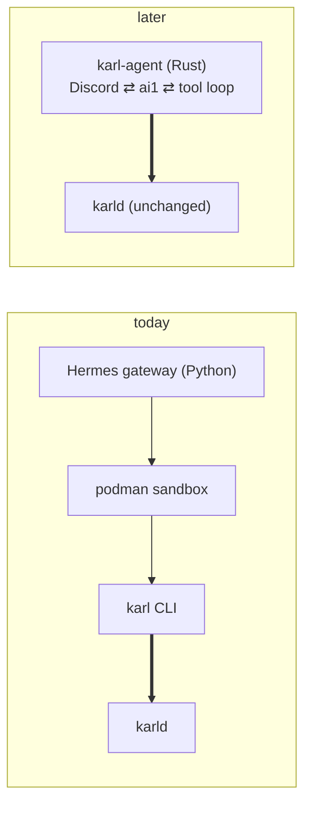

# Own harness

Karl is agent-agnostic by construction: the agent is one more socket client.
Hermes today, a Rust process tomorrow, your terminal always. This page is the
plan for tomorrow.

## What changes, what does not

| | Today | Later |
| --- | --- | --- |
| who talks to the socket | `karl` in the sandbox | `karl-agent`, directly |
| `karld` | unchanged | unchanged |
| the command grammar, the index, the line formats | same | same |
| the system prompt text about `karl` | same | same |
| podman sandbox | needed by Hermes's terminal tool | gone: the agent has no general terminal |
| python, uv, node on the box | yes | no |
| system prompt size | ~14K tokens | ~2K |

`karl-agent` would link `karl-core` for the command table (so it can
dispatch `karl …` text without the CLI) but still call the daemon over the
socket: the credential holder stays a separate process from the one that
talks to the internet on the model's behalf.

## What has to be built

| Part | Effort | Notes |
| --- | --- | --- |
| Discord gateway | medium | `serenity` or `twilight`; 2000-char splits, typing indicator, allowed users |
| tool-call loop | fiddly | llama-server `--jinja` tool calls, malformed JSON, max iterations, qwen3 thinking tokens |
| prompt-cache discipline | design rule | stable prefix, append-only messages; easy to break by accident |
| memory | easy | a file per profile, a `remember` tool |
| context compaction | hard | 64K fills; summarising on CPU takes minutes; what survives is a judgement call. Hermes iterated this for many releases |
| cron | easy | tokio timers, jobs in SQLite |
| web search | small | one keyed provider over HTTPS |
| terminal / sandbox | skip | the biggest simplification: no podman, no general shell, the threat model shrinks to "reads your data through policy, posts on Discord" |

A minimal version (Discord, loop, `karl`, memory, crude compaction) is a few
thousand lines. Polish parity with Hermes is months, and Hermes keeps moving.

## Why bother

Goal one, tokens: a 2K prompt against 14K on a CPU model where a cache miss
re-reads the whole prefix. Goal two, security: no sandbox, no fetch tool, so
the exfiltration path in [Security](security.md) closes. Goal three, Rust end
to end on the box.

## When

After measuring. Add Karl to the Hermes profile, read prompt token counts
for a week, then decide with numbers.
