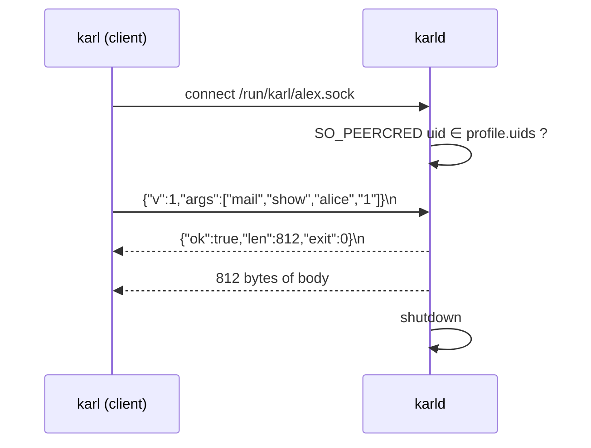

# Protocol

What crosses the unix socket. One request per connection: connect, one line,
one reply, close. No multiplexing, no auth header. Identity is the socket path
plus the peer's uid.



## Request

One JSON line, argv verbatim:

```json
{"v":1,"args":["mail","show","alice","1"]}
```

- `v`: protocol version, `1`. Anything else is refused.
- `args`: at most 64 strings. The client passes its argv untouched: it knows no grammar.
- The line must be under 4096 bytes; longer is dropped unread with exit 2.

## Reply

A JSON header line, then exactly `len` bytes of body:

```text
{"ok":true,"len":812,"exit":0}\n
gm Alice Smith: Re: invoice Q3 — …
```

On error the body is the message, `ok` is false, `exit` is the code the CLI
should exit with:

```text
{"ok":false,"len":41,"exit":2}\n
mail: unknown command; `karl` alone lists commands
```

The body always ends with a newline. The CLI prints it to stdout when `ok`,
to stderr otherwise.

## Limits, hard-coded in the daemon

| | |
| --- | --- |
| request line | ≤ 4096 bytes |
| args | ≤ 64 |
| reply | ≤ `max_bytes` from the profile |
| whole request | 20 s, live lookups included |
| concurrent requests per profile | 4; the fifth gets `busy, retry` |

## Socket paths

| Path | Mode | Who | Verbs |
| --- | --- | --- | --- |
| `/run/karl/<profile>.sock` | 0660 `karl:karl-cli` | the profile's uids | the command table |
| `/run/karl/admin.sock` | 0600 `karl` | uid `karl` or root | `status`, `sync [source]`, `purge`, `approvals`, `approve <id>`, `deny <id>` |

The admin verbs are not in the profile parser at all: read-only by
construction, not only by configuration.

## From the laptop

ssh forwards unix sockets:

```sh
ssh -L /tmp/karl.sock:/run/karl/alex.sock hermes1
KARL_SOCK=/tmp/karl.sock karl new
```

The CLI picks the socket in this order: `KARL_SOCK`, `/run/karl.sock` (the
sandbox mount), `/run/karl/$USER.sock`.

## Why not HTTP, gRPC, or the database

HTTP would add a port, TLS and an auth header for nothing: the peer uid is
the authentication. gRPC is a dependency for two JSON lines. Mounting the
SQLite file read-only into the sandbox would bypass the policy and expose the
whole cache.
