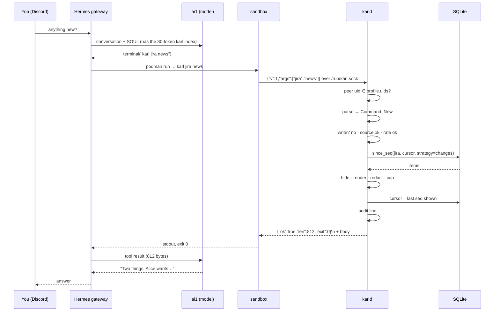

# One request

What happens between "anything new on Jira?" on Discord and the answer.

No network call happens on the request path. The sync loop filled the cache
earlier. The one exception is a live Jira lookup (`jira q`, `jira comments`,
or `jira show` of an issue outside the sync window), which goes to the API
with a 20 s overall timeout.

## Enforcement order, in code

`karld::dispatch::handle`, top to bottom:

1. **Parse** argv against the command table. Unknown verb → exit 2 with the
   usage line. The parser is the only grammar; the CLI has none.
2. **Write authorization.** A write verb on a source the profile is
   `not-authorized` for is refused with exit 3, before any lookup. Allowed
   writes continue: `authorized` executes after the rate check,
   `authorization-required` queues for a human.
3. **Source present?** A group without a source for this profile → exit 2,
   `no mail source for this profile`.
4. **Rate.** Sliding window per profile (`60/h`). Over → exit 4, retry hint.
5. **Query** the store, filtered to the profile's sources and the command's kind.
6. **Hide** rules drop items (bank mail, OTP senders, private events).
7. **Render** one line per item; fold chat threads; cut bodies.
8. **Redact** patterns (`otp`, `card`) on the final text.
9. **Cap** at `max_lines` / `max_bytes` with a `(+N more)` tail.
10. **Audit**: `profile uid args exit bytes ms`.

## What `new` means

`news` is *since you last asked*, per profile and per source. The first ask on
a source sets its cursor to now and answers `nothing new (tracking jira from
now)`: a backlog of 700 issues is not news. When the answer is capped, the
cursor advances only to the last item shown, and the reply ends with
`(more: run again)`. `karl jira news` touches only the Jira cursor.

What counts as new is the source's strategy: Jira and Calendar report
`changes` (a status move or a reschedule is news), Gmail reports `arrivals`
(a mail is news once, when it arrives). See [Commands](commands.md).

After a context loss the agent can fall back to `mail recent 2h`, which is
not consuming.
