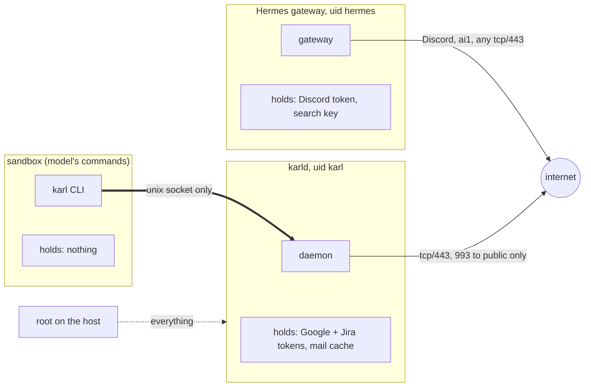

# Security

Karl exists so that an agent can read personal data without holding a single
credential. This page says what that buys, and what it does not.

## Who holds what, who reaches what



| Actor | Holds | Can reach |
| --- | --- | --- |
| Sandbox, where the model's commands run | nothing | the socket, nothing else (`--network=none`) |
| Hermes gateway (uid `hermes`) | Discord token, search key | Discord, ai1, any tcp/443, as today |
| `karld` (uid `karl`) | Google and Jira tokens, the cache | tcp/443 and 993 to public hosts only; every private range dropped |
| root on the host | everything | everything |

## What stops what

| Attack | Stopped by |
| --- | --- |
| Model is tricked into reading secrets (`cat ~/.config/…`) | the sandbox has no secrets and no home mount. Unchanged from the Hermes setup |
| Model sends something clever through the socket | the socket speaks only the verbs in the command table. No SQL, no paths, no shell. A request over 4 KiB is dropped unread |
| Model tries a write | three layers. The profile's mode on that source, `not-authorized` by default, refuses it before any lookup. `authorization-required` queues it for a human on the admin socket. The source's write path accepts two verbs and, for Jira, only `/rest/api/3/issue/…` paths; Google tokens carry read-only scopes, checked at start, so Gmail and Calendar cannot write at all |
| Another local user connects to the socket | socket is `karl:karl-cli` 0660 and the daemon checks `SO_PEERCRED` against the profile's uid list |
| A profile reads another person's sources | each profile has its own socket path; the daemon maps path → profile → allowed sources. Asami's socket never answers for Alex's mail |
| Model dumps the whole mailbox | `max_lines`, `max_bytes` per reply and `rate` per hour. A dump takes many calls and shows in the audit log |
| OTP codes or card numbers leak into the model's context | `hide` drops the senders, `redact` scrubs the patterns before the text leaves the daemon |
| Crafted mail exploits a parser bug in `karld` | Rust memory safety; a systemd unit with no capabilities, `ProtectSystem=strict`, `ProtectHome`, syscall filter; the egress table. Worst case: the attacker reads the cache and read-only tokens from inside uid `karl` |
| Root on the host | not stopped. Same as today, with more to take |

## What Karl does not protect

**Exfiltration through the gateway.** Content the model reads from mail is
untrusted input. A prompt injection can make the model run `karl mail find
password` and then send the result somewhere. Not through the sandbox, which
has no network, but through the gateway's own web-fetch tool, which can
reach any tcp/443 host. The Hermes threat model already lists this path for
memory and session data; Karl makes what is behind it more valuable.

Mitigations, cheap to strong:

1. Output caps and the hourly rate limit (on by default). A dump is slow and visible.
2. Disable the gateway's web-fetch tool for the profile.
3. The own harness ([Own harness](harness.md)), which simply has no fetch tool.

**Root.** All of the above protects against the agent and against other
users. It does not protect against root on the host. Keep the host's own
rules: no password for service users, ssh from the LAN only, patched.

## Secrets at rest

`/var/lib/karl/secrets.toml`, mode 0600, owner `karl`. The daemon refuses to
start if the mode is wider. Options to go further, in order of effort:

- key file as today, protected by the host's disk encryption;
- `systemd-creds` sealed to the TPM, so the file is never in clear on disk;
- a passphrase at start, strongest at rest, but every reboot waits for a human.

Every option protects against disk theft and backup leaks. None protects
against root on a running host.

## Audit

One line per request in `/var/log/karl/audit.log`:

```text
2026-10-13T13:45:45+09:00 alex uid=1001 "jira comment HT-36 hello" exit=3 42B 0ms
2026-10-13T13:45:45+09:00 alex uid=1001 "rm -rf /" exit=2 47B 0ms
```

Writes get their own lines: `WRITE` (executed), `WRITE-QUEUED #12`, `admin
APPROVED #12`, `admin DENIED #12`. Refused peers, over-long requests and
timeouts are logged too. The file is 0600 under uid `karl`; the agent cannot
read or edit it.
